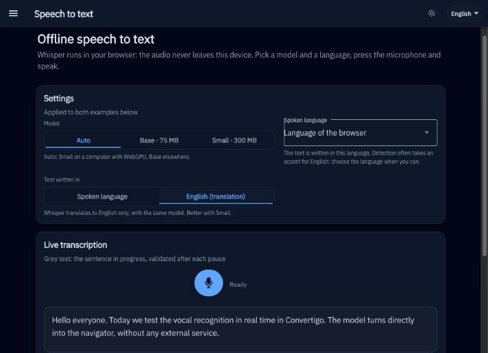
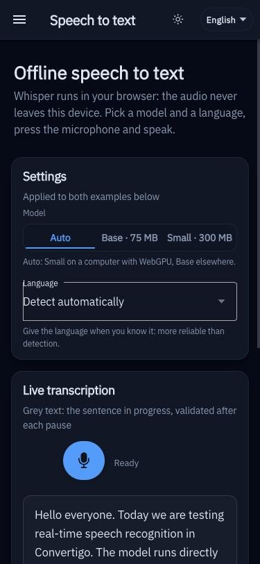

# lib_SpeechToText_ui_ngx

Offline speech-to-text for Convertigo NGX applications. [Whisper](https://github.com/openai/whisper) runs **in the
browser** (Web Worker, WebGPU or WebAssembly): the audio never leaves the device and no external service is called.
Works in Chrome, Edge, Safari and Firefox, on computers and phones, in 99 languages.



- [Installation](#installation)
- [Models](#models)
- [Languages](#languages)
- [Shared component speechToText_sc](#shared-component-speechtotext_sc)
- [Shared actions](#shared-actions)
- [How it works](#how-it-works)
- [Build](#build)
- [Licence](#licence)

## Installation

1. Import the library in your project: in the Studio, import a project from this remote URL (or add it as a
   project reference):

   ```
   lib_SpeechToText_ui_ngx=https://github.com/convertigo/c8oprj-lib-speech-to-text.git:branch=8.4.0.0
   ```

2. Deploy on the Convertigo server of your application:
   - `lib_SpeechToText_ui_ngx`: it serves the runtime (`DisplayObjects/stt`) to the browsers;
   - at least one model project, from the CARs of the releases of
     [c8oprj-lib-speech-to-text-models](https://github.com/convertigo/c8oprj-lib-speech-to-text-models) (the model files
     are not in git):

| Project | Model | Size | Used by "auto" on |
| --- | --- | --- | --- |
| `lib_SpeechToText_model_whisperBase` | Whisper base | 98 MB | phones, tablets and computers without WebGPU |
| `lib_SpeechToText_model_whisperSmall` | Whisper small | 302 MB | computers with WebGPU |

3. Drop `speechToText_sc` in a page and handle its `Final` event (see the `testSpeechToText` page of this project).

The microphone needs a secure page: `https://` or `localhost`.

## Models

Each browser downloads only the model it uses, once, and keeps it in its Cache Storage.

| Device | Model | Runs on | Download | One pass, measured on a Mac |
| --- | --- | --- | --- | --- |
| Computer with WebGPU | Whisper small q4 | WebGPU | 300 MB | 0.5 s |
| Phone or tablet with WebGPU | Whisper base, q4 encoder + q8 decoder | WebGPU + WebAssembly | 73 MB | 0.47 s |
| No WebGPU | Whisper base q8 | WebAssembly | 77 MB | 2.3 s |

With `model: 'auto'`, when only `lib_SpeechToText_model_whisperBase` is deployed, computers use Whisper base too.
When WebGPU is announced but fails, the engine falls back to Whisper base on WebAssembly.

To serve the models from elsewhere (a CDN, another server), set the global symbol `lib_speechtotext.models.url` to a
folder holding `onnx-community/whisper-base/` and `onnx-community/whisper-small/` (the `DisplayObjects/models` folders
of the model projects), or give `modelsUrl` to the component. The symbol is compiled when the application is built.

## Languages

Whisper base and small are multilingual: one model recognises 99 languages. `language` is the language the user
speaks, and the text is written in it:

| `language` | Language used |
| --- | --- |
| `''` (default) | the first language of the browser that Whisper knows (`fr-FR` gives French) |
| `'fr'`, `'en-US'`… | the language of this ISO code |
| `'french'`, `'english'`… | this Whisper language name |
| `'auto'` | detected by Whisper at each pass |

Avoid `'auto'` when you can: on short pieces of speech and real microphones, the small models often take an accent for
English, and then write English while the user speaks another language. The `Ready` event gives the language used.

### Translation to English

With `task: 'translate'`, Whisper writes English whatever the spoken language, live like a transcription (provisional
text, then validated sentences), with the same model and no extra download. Whisper translates to English only, and
the translation stays literal; it is better with Small than with Base. Keep `language` set to the spoken language.

English is recognised best, then the main European languages (good with Small, correct with Base); languages with
little training data are much weaker with these small models.



## Shared component speechToText_sc

A microphone button with an optional state line. Several components can share a page: they share one engine, one
model and one microphone, and each receives only the text of its own dictation.

| Variable | Default | Description |
| --- | --- | --- |
| `model` | `'auto'` | `'auto'`, `'base'` or `'small'` |
| `language` | `''` | spoken language: empty for the browser language, an ISO code (`'fr'`), a Whisper name (`'french'`) or `'auto'` (see [Languages](#languages)) |
| `task` | `'transcribe'` | `'transcribe'` writes in the spoken language, `'translate'` writes English |
| `modelsUrl` | `'${lib_speechtotext.models.url=}'` | folder holding `onnx-community/<model>/`; empty: the model projects of the server |
| `micProcessing` | `true` | echo cancellation, noise suppression and automatic gain of the browser; turn it off if words are cut or distorted |
| `preload` | `true` | load the model when the component shows, or at the first click |
| `showStatus` | `true` | show the state (loading, listening, errors) next to the button |
| `label` | `''` | text of the button next to the microphone icon |

| Event | Value |
| --- | --- |
| `Partial` | provisional text of the sentence in progress, several times per second |
| `Final` | validated sentence, after each pause and at the stop |
| `Done` | everything said before the stop is transcribed |
| `Ready` | `{model, device, reason, loadMs, language, task}` |
| `StateChanged` | `{status, ready, loading, listening, finishing, speaking, level, model, device, reason, loadMs, progress, error, language, task}` |
| `Stats` | `{kind: 'partial' or 'final', ms, audioS}` for each transcription pass |
| `Error` | message: microphone refused, model project not deployed, worker failure |

Typical use, dictation into a field: a `CustomAction` on `Final` with
`page.local.note = ((page.local.note || '') + ' ' + event).trim();`.

## Shared actions

| Action | Variables | Result |
| --- | --- | --- |
| `speechToTextPreload_sa` | `model`, `language`, `task`, `modelsUrl` (same as the component) | loads the model in advance, resolves with `{model, device, reason, loadMs}` |
| `speechToTextStop_sa` | | stops the microphone and resolves once the last sentence is transcribed |

The `testSpeechToText` page preloads the model on `onWillEnter` and stops the microphone on `onWillLeave`. It also lets
you choose the model, the spoken language and the language of the text (spoken or English), shows the measured time of each pass, and fills a text area by dictation.

## How it works

Files served by the library from `DisplayObjects/stt`:

| File | Role |
| --- | --- |
| `stt-engine.js` | page-side engine, one per browser tab (`window.__c8oSpeechToText`): worker, microphone, events |
| `stt-worker.js` | Web Worker: model choice, voice detection, transcription |
| `stt-capture-worklet.js` | AudioWorklet: microphone to mono 16 kHz chunks of 100 ms |
| `lib/transformers.min.js` | [transformers.js](https://github.com/huggingface/transformers.js) 4.3.2 |
| `lib/ort-wasm-simd-threaded*.{mjs,wasm}` | [onnxruntime-web](https://github.com/microsoft/onnxruntime) 1.31.0-dev.20260914-8d85527a0 (plain and WebGPU builds) |
| `test/*.wav` | English and French test recordings (macOS `say`) |

Whisper is not a streaming model, so the live text comes from a sliding window. The worker detects speech (adaptive
energy threshold), transcribes the sentence in progress again as soon as the previous pass ends (`Partial`), and after
a 0.7 s pause (or 20 s of speech) transcribes it one last time (`Final`). The phrases Whisper invents on noise
("Thanks for watching", "Sous-titres réalisés par…", "Gracias por ver"…) are dropped in English, French, Spanish,
German, Italian and Portuguese.

The WebAssembly runtime uses one thread, or up to four when the app is cross-origin isolated
(`Cross-Origin-Opener-Policy: same-origin` and `Cross-Origin-Embedder-Policy: require-corp`).

## Build

```bash
./gradlew car -Pconvertigo.performsMobileBuild=false   # build/lib_SpeechToText_ui_ngx.car, without the example app
```

## Licence

Apache-2.0 (see `LICENSE`). Third-party components and their licences are listed in `NOTICE`.
